# Parquet

**Un tableau de bord NBA en direct doublé d'une encyclopédie, en français, qui tourne sur ton ordinateur.**

Parquet affiche les scores des matchs en temps réel, le détail de chaque rencontre (box score, scénario du match, fil des actions, carte des tirs) et une fiche complète pour les 30 franchises et les plus de 5 000 joueurs passés par la NBA depuis 1946. Toutes les données viennent des sources publiques de NBA.com et de Wikipédia, sans compte ni clé d'API.

Pour l'essayer sans connexion : `python run.py --demo` lance l'application sur des données fictives.


<sub>Les captures de cette page utilisent des données de démonstration : joueurs fictifs, logos remplacés par des pastilles.</sub>

## Fonctionnalités

**Suivi des matchs**
- Scores de la journée rafraîchis automatiquement pendant les matchs, avec l'avancement de chaque quart-temps.
- « Cette nuit en NBA » : au réveil, le résumé des matchs de la nuit (performance de la nuit selon le Game Score, meilleurs marqueurs, rebondeurs et passeurs, triples-doubles, match le plus serré, plus large victoire, prolongations).
- Horaires convertis à l'heure de Paris, navigation de jour en jour jusque dans les saisons passées.
- Page de match : score par quart-temps, scénario du match (courbe de l'écart au score, plus gros écarts, changements de leader), duel statistique des deux équipes, meilleurs joueurs, box score complet, fil des actions filtrable et carte des tirs.
- Mode multi-matchs : plusieurs rencontres en direct côte à côte, en plein écran, avec les dernières actions et un signal des fins de match serrées.
- Avant le coup d'envoi : forme récente des deux équipes. La page bascule seule en mode direct au début du match.

**Encyclopédie et analyse**
- Équipes : effectif, staff, calendrier mois par mois (V vert ou D rouge et score pour les matchs joués, horaire pour les prochains), résumé historique, titres, maillots retirés, membres du Hall of Fame, victoires saison par saison.
- Équipes : export du calendrier de la saison au format `.ics`, à importer dans Google Agenda, Apple Calendrier ou Outlook.
- Joueurs : recherche dans toute l'histoire de la ligue, filtres (équipe, poste, pays), biographie, palmarès, parcours, records, statistiques de carrière par match, sur 36 minutes ou en totaux, stats avancées (adresse réelle TS%, adresse effective eFG%, passes par balle perdue, part de tirs à 3 points), derniers matchs.
- Comparateur de joueurs : duel face-à-face (carrière, saison actuelle, playoffs), comparaison détaillée des palmarès, courbes de trajectoire superposées saison par saison (S1, S2, ...) et sélection rapide de duels légendaires.
- Tableau des playoffs : arbre complet de la post-saison NBA (1er tour, demi-finales, finales de conférence, Finales NBA), statut et avancement des séries (4-1, 4-2...), détail match par match avec scores, lien vers les box scores et sélecteur de saisons historiques.
- Classement par conférence et leaders statistiques de la saison.

**Confort et mobilité**
- Recherche instantanée accessible partout (touche `/`).
- Alertes en direct, tant qu'un onglet Parquet est ouvert : coup d'envoi et résultat des équipes favorites, fins de match serrées selon la définition de la NBA (5 dernières minutes, 5 points d'écart ou moins). Notifications système quand la connexion le permet, alertes dans la page sinon ; une alerte n'est jamais envoyée deux fois.
- Mode anti-spoiler pour regarder les matchs en différé : scores, box score, fil des actions, résumé de la nuit, champion des playoffs et alertes restent masqués jusqu'à ce qu'on les révèle, match par match ou d'un coup. Les révélations sont retenues pendant la session.
- Progressive Web App (PWA) : installable sur ordinateur, et sur téléphone via une connexion sécurisée (voir le guide), fonctionnement hors ligne avec les dernières données connues.
- Équipes favorites mises en avant, thème sombre ou clair adapté aux préférences système.
- Habillage « Arena » inspiré des retransmissions sportives : titres en Oswald, texte en Barlow, noir carbone (ou gris clair) et orange ballon.
- Page « État des sources » pour diagnostiquer un problème de connexion.

## Captures

| Cette nuit en NBA | Scénario du match |
| --- | --- |
| 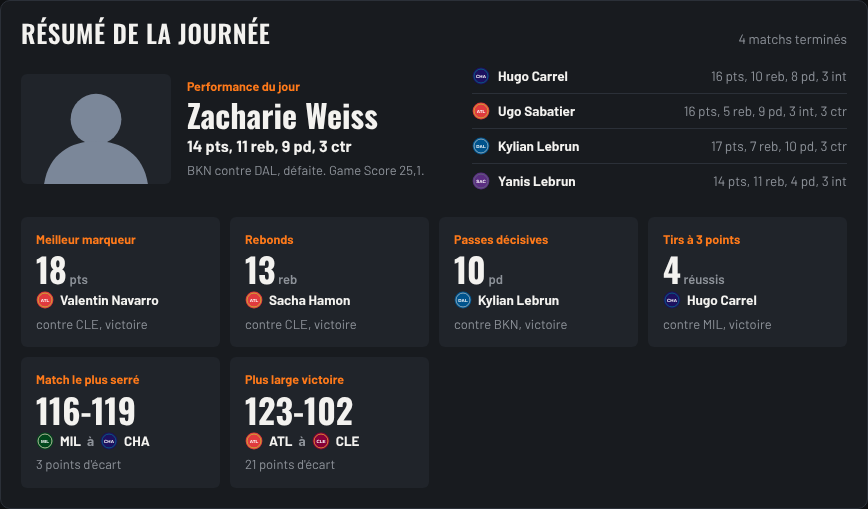 | 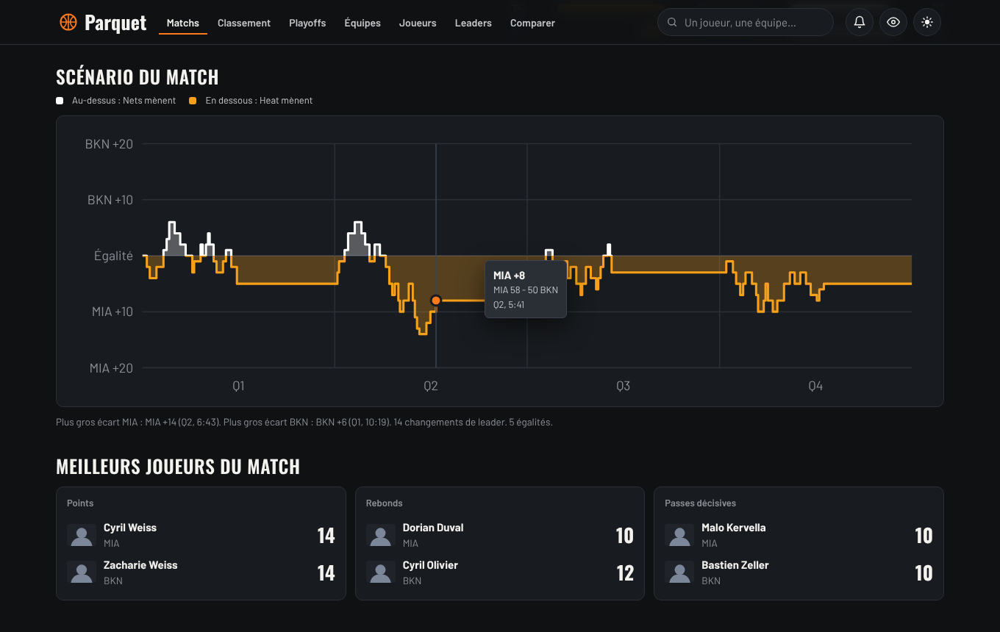 |
| **Carte des tirs** | **Multi-matchs** |
| 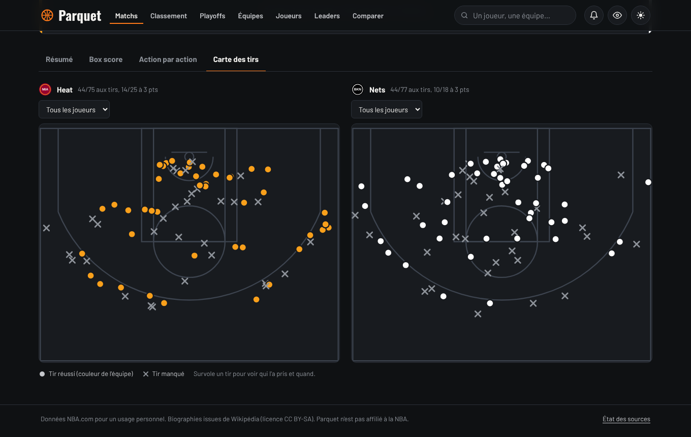 | 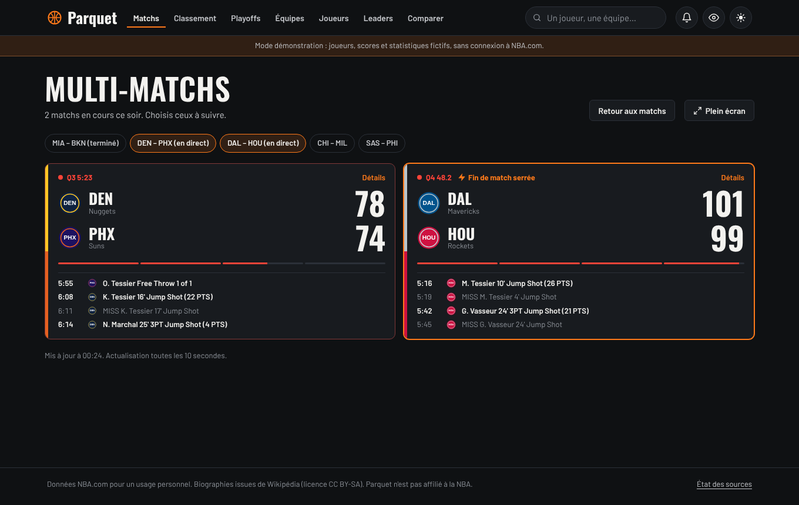 |
| **Arbre des playoffs** | **Statistiques d'un joueur** |
| 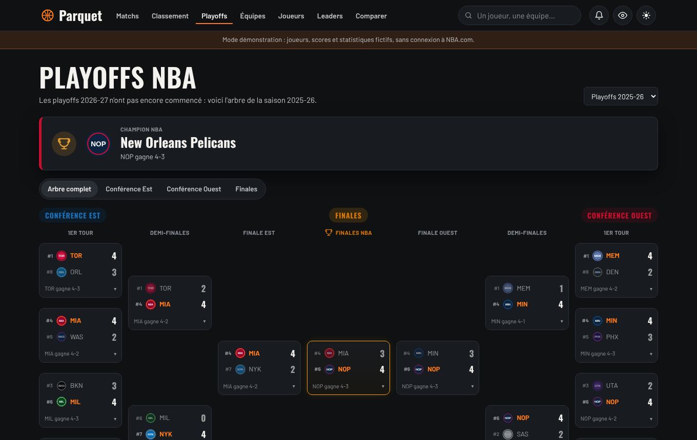 | 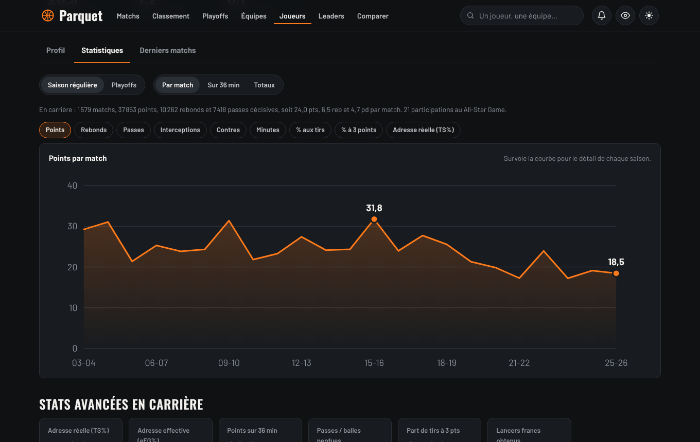 |
| **Comparateur** | **Mode anti-spoiler** |
| 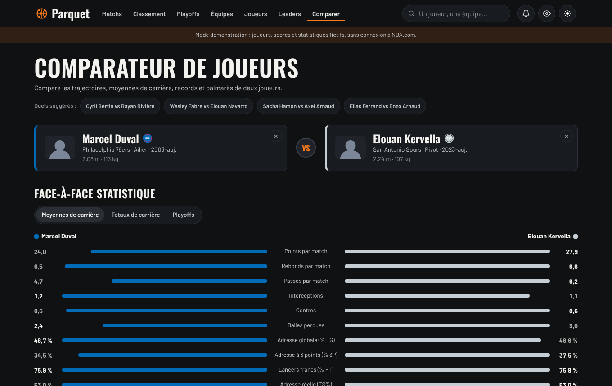 | 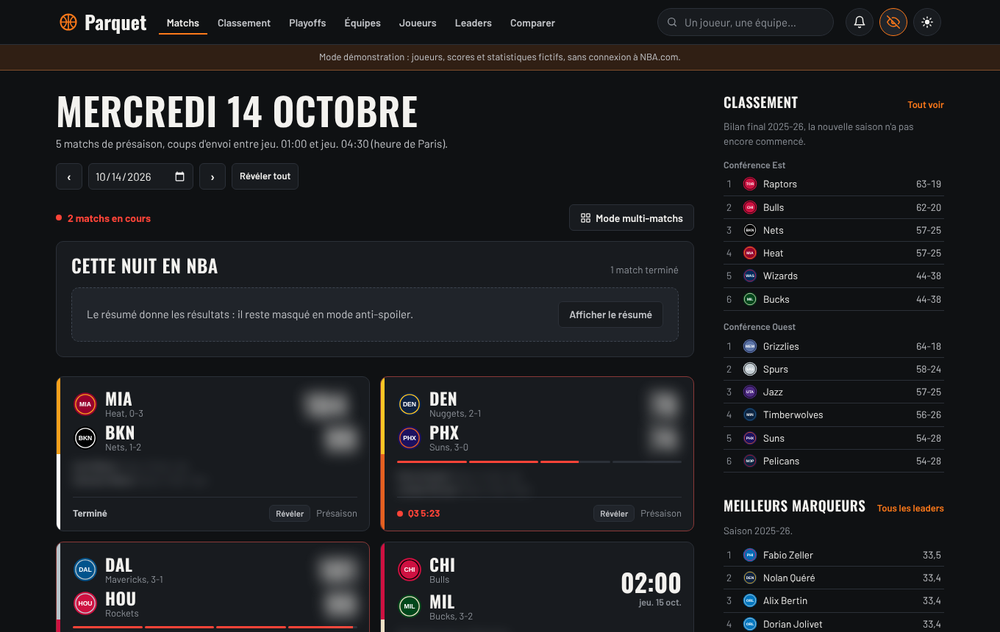 |
| **Fiche d'équipe, thème clair** | **Sur téléphone** |
| 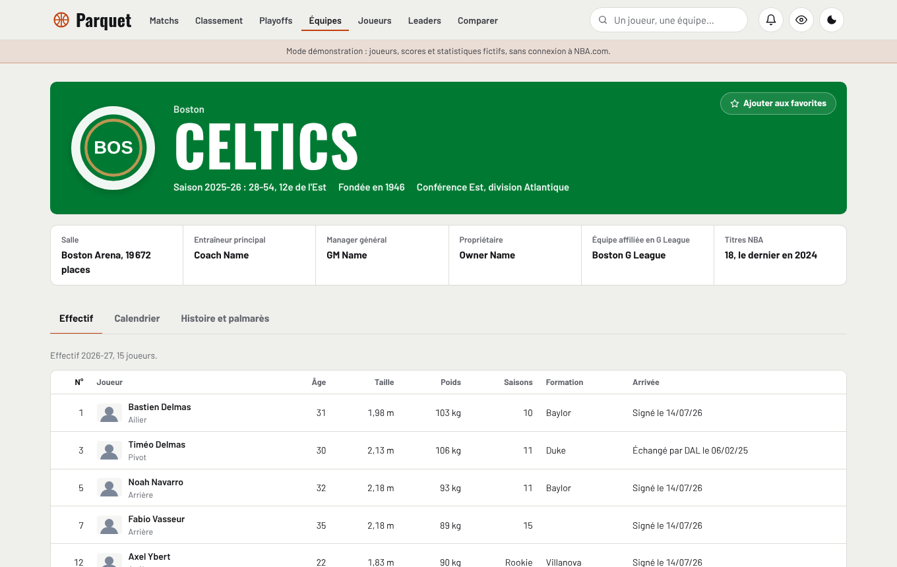 | 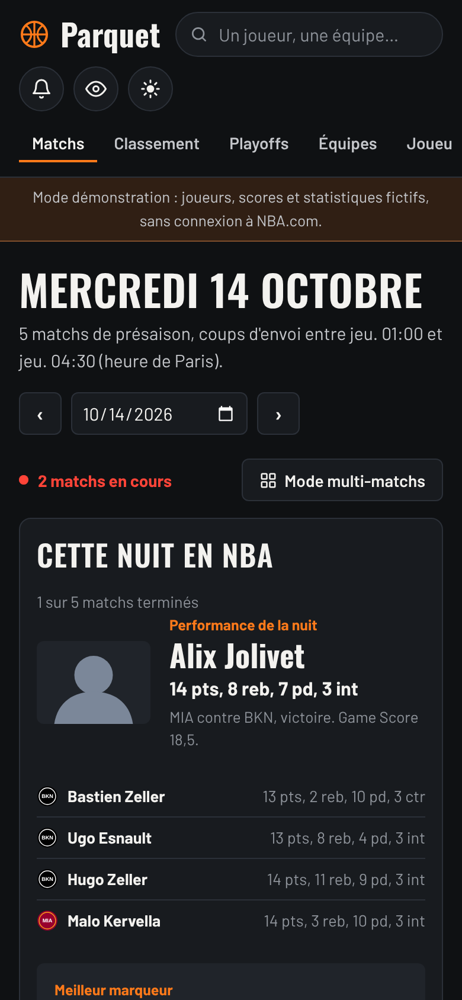 |

Les captures sont générées automatiquement à partir du mode démo : `python scripts/captures.py`.

## Stack technique

| Couche | Choix | Pourquoi |
| --- | --- | --- |
| Serveur | Python 3.9+, bibliothèque standard (`http.server`, `sqlite3`) et `requests` | Une seule dépendance, installation en un double-clic |
| Cache | SQLite + cache mémoire LRU | Réponses instantanées, fonctionnement dégradé hors ligne |
| Interface | HTML, CSS et JavaScript (modules ES) sans framework ni étape de build | Code lisible, aucun outillage à installer |
| Graphiques | SVG écrit à la main | Contrôle total du rendu, accessibilité clavier |
| Données | CDN et API stats de NBA.com, Wikipédia, Wikidata | Sources gratuites et publiques |

## Architecture

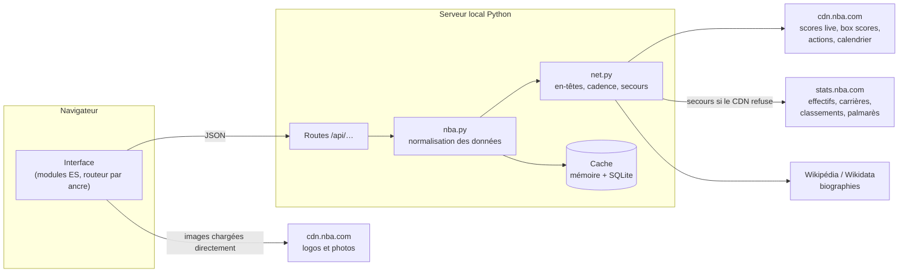

Le navigateur ne parle qu'au serveur local, qui interroge les sources, normalise les réponses dans un format stable et les met en cache. Le détail (routes, durées de cache, modèle de données) est dans [docs/ARCHITECTURE.md](docs/ARCHITECTURE.md).

## Points techniques notables

**Travailler avec des API non documentées.** Les flux de NBA.com n'ont pas de documentation publique. Leur format a été relevé sur des réponses réelles, puis chaque champ est lu de façon défensive. Les requêtes reprennent les en-têtes du site officiel, avec un second jeu en secours, et la cadence vers `stats.nba.com` est limitée (deux requêtes simultanées, espacement minimal) pour ne pas être bridé.

**Résilience.** Chaque donnée a une durée de fraîcheur adaptée : 8 secondes pour un match en cours, 6 heures pour un match terminé, une journée pour l'histoire d'une franchise. Si une source ne répond pas, le serveur renvoie la dernière version connue et l'interface l'indique par un bandeau, plutôt qu'une page d'erreur. Si le CDN refuse l'accès, scores, box scores et actions basculent automatiquement sur les endpoints équivalents de `stats.nba.com`.

**Temps réel sans WebSocket.** L'interface interroge le serveur à un rythme qui dépend de l'état des matchs (15 secondes en direct, plus lent avant le coup d'envoi, arrêt quand rien ne bouge) et se met en pause quand l'onglet est masqué. Un panier marqué fait brièvement ressortir le score.

**Le bon article Wikipédia.** Plusieurs joueurs portent le même nom. Plutôt qu'une recherche textuelle, Parquet interroge Wikidata avec l'identifiant NBA.com du joueur (propriété P3647) pour trouver l'article exact, en français s'il existe.

**Visualisation.** Courbe de carrière avec réticule et infobulle, scénario du match en escalier (l'écart reste constant jusqu'au panier suivant) coloré par équipe de part et d'autre de l'égalité, colonnes de victoires par saison, duel des équipes en barres opposées, carte des tirs dessinée dans le système de coordonnées de la NBA (dixièmes de pied, panier en origine). Les couleurs d'équipe sont choisies selon leur contraste avec le fond, et deux équipes aux couleurs trop proches sont différenciées (distance mesurée dans l'espace OKLab).

**Localisation.** Dates et nombres au format français, tailles en mètres, poids en kilos, postes, récompenses et indicateurs de classement traduits, horaires à l'heure locale.

**Mode démo et tests de bout en bout.** Un module de données fictives reproduit fidèlement la structure des réponses de NBA.com (scores en direct, box scores, actions, carrières, playoffs…), avec un générateur à graine fixe. Il permet d'essayer Parquet hors ligne, de faire tourner les tests d'interface dans un vrai navigateur et de régénérer les captures de cette page.

**Calendrier et notifications.** Le calendrier d'une équipe est exporté au format iCalendar (RFC 5545 : lignes repliées à 75 octets, échappement, horaires en UTC convertis par l'agenda). Les notifications tiennent compte des contraintes des navigateurs : elles ne sont autorisées que sur une connexion sécurisée, ce que l'interface détecte pour expliquer la marche à suivre.

**Sécurité et accessibilité.** Les textes issus des sources sont toujours insérés comme du texte (jamais via `innerHTML`). Le serveur n'écoute que sur la machine locale par défaut (l'accès depuis le téléphone est une option explicite) et refuse toute sortie du dossier `web/`. Navigation au clavier, focus visible, mouvements réduits respectés.

## Lancer le projet

```bash
git clone <adresse-du-dépôt> parquet-nba
cd parquet-nba
python -m pip install -r requirements.txt
python run.py
```

L'application s'ouvre sur `http://localhost:8765/`. Sous Windows et macOS, les lanceurs `lancer.bat` et `lancer.command` créent l'environnement Python et démarrent tout en un double-clic ; `lancer-telephone.bat` et `lancer-telephone.command` font de même en rendant Parquet accessible depuis le téléphone. Le [guide d'utilisation](docs/GUIDE-UTILISATEUR.md) détaille l'installation, l'accès depuis un téléphone et le dépannage.

Options de `run.py` : `--port`, `--lan` (accès depuis le Wi-Fi de la maison), `--demo` (données fictives, sans connexion), `--no-browser`, `--diagnostic` (teste les sources puis s'arrête), `--vider-cache`.

## Tests

```bash
python -m unittest discover -s tests -t . -v        # tests unitaires (sans réseau)

pip install playwright && python -m playwright install chromium
python -m unittest tests.test_ui -v                 # tests d'interface dans Chromium
```

Les tests unitaires couvrent la mise en forme des données (à partir d'échantillons au format réel de NBA.com), la détection des paniers, l'arbre des playoffs et les têtes de série issues du play-in, le résumé d'une journée, les stats avancées, l'export iCalendar, le cache (y compris le repli sur des données périmées) et la cohérence du mode démo.

Les tests d'interface lancent le serveur en mode démo et pilotent un vrai navigateur : affichage des matchs et du résumé, onglets d'un match, mode anti-spoiler (masquage et mémoire des révélations), arbre des playoffs replié, stats avancées, comparateur (chaque fiche chargée une seule fois), calendrier mensuel et export du calendrier, multi-matchs et absence de défilement horizontal sur téléphone.

GitHub Actions lance les tests unitaires sur Python 3.9, 3.11 et 3.13, et les tests d'interface dans Chromium.

## Organisation du code

```
parquet-nba/
├── run.py                  point d'entrée (serveur, ouverture du navigateur, diagnostic)
├── parquet/                serveur Python
│   ├── server.py           serveur HTTP, routes /api, fichiers statiques
│   ├── nba.py              récupération et normalisation des données NBA
│   ├── net.py              accès réseau : en-têtes, cadence, gestion des erreurs
│   ├── cache.py            cache mémoire + SQLite avec repli sur données périmées
│   ├── wiki.py             biographies via Wikidata et Wikipédia
│   ├── demo.py             données de démonstration (mode --demo, tests, captures)
│   └── teams_meta.py       les 30 franchises (couleurs, conférences, articles)
├── web/                    interface
│   ├── index.html, manifest.webmanifest, sw.js (PWA), css/, fonts/, img/
│   └── js/                 routeur, composants, graphiques SVG, anti-spoiler, alertes, une vue par page
├── tests/                  tests unitaires et tests d'interface (Playwright)
├── scripts/captures.py     régénère les captures de la documentation
└── docs/                   guide d'utilisation, architecture, captures
```

## Données, droits et licence

- **Code** : licence [MIT](LICENSE).
- **Polices** : Oswald (titres) et Barlow (texte), incluses sous licence SIL Open Font License (fichiers dans `web/fonts/`).
- **Données, logos et photos NBA** : ils ne sont pas inclus dans ce dépôt. L'application les télécharge au moment de l'utilisation, depuis les sources publiques de NBA.com, et ils restent la propriété de la NBA et de leurs ayants droit. Les conditions d'utilisation de NBA.com réservent ces contenus à un usage personnel : Parquet est conçu pour être lancé par chacun sur son propre ordinateur, pas pour être hébergé publiquement.
- **Textes Wikipédia** : affichés avec un lien vers l'article et la mention de la licence CC BY-SA.

Parquet est un projet personnel indépendant, sans lien avec la NBA ni ses équipes.

## Pistes d'amélioration

- Notifications même quand Parquet est fermé (notifications push, qui demandent un serveur en ligne).
- Mode multilingue (anglais, espagnol) pour les statistiques et les récompenses.
- Statistiques d'équipe avancées (Net Rating, Pace) et cartes de tirs comparées entre deux joueurs.
