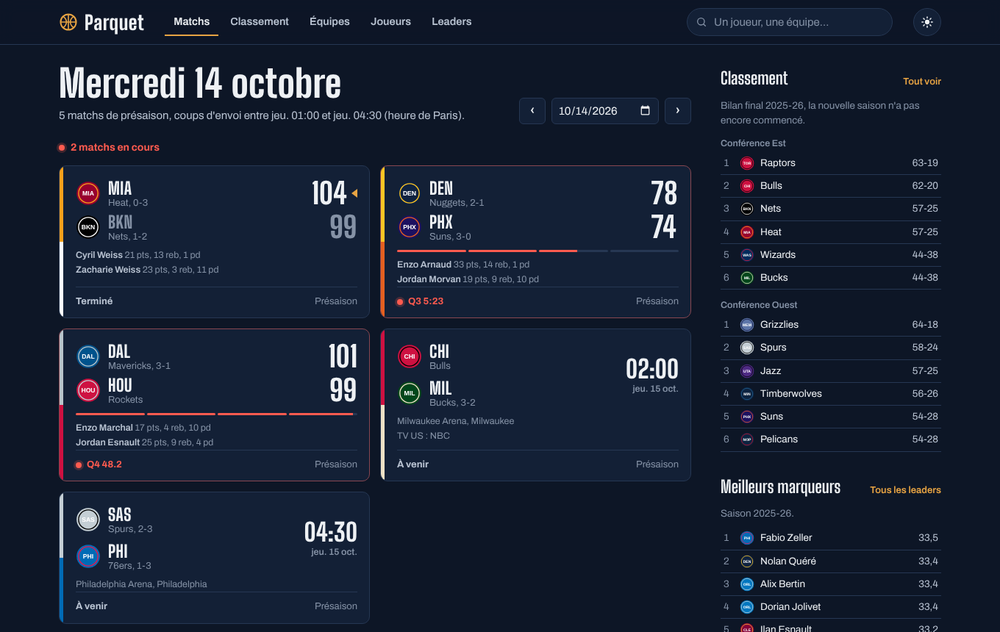
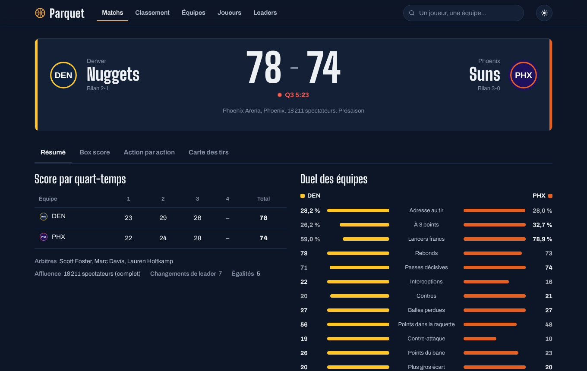
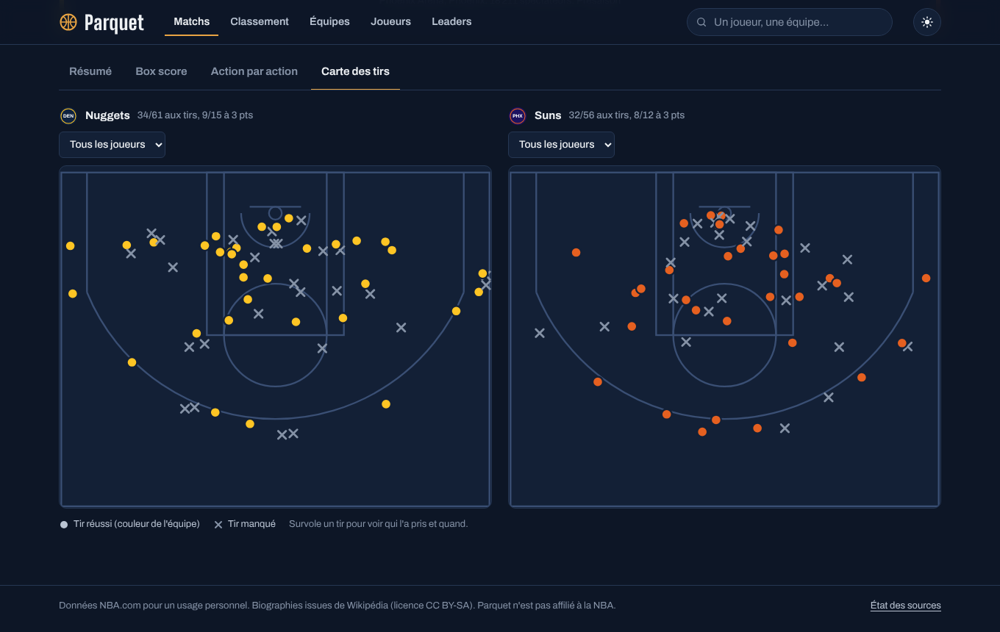
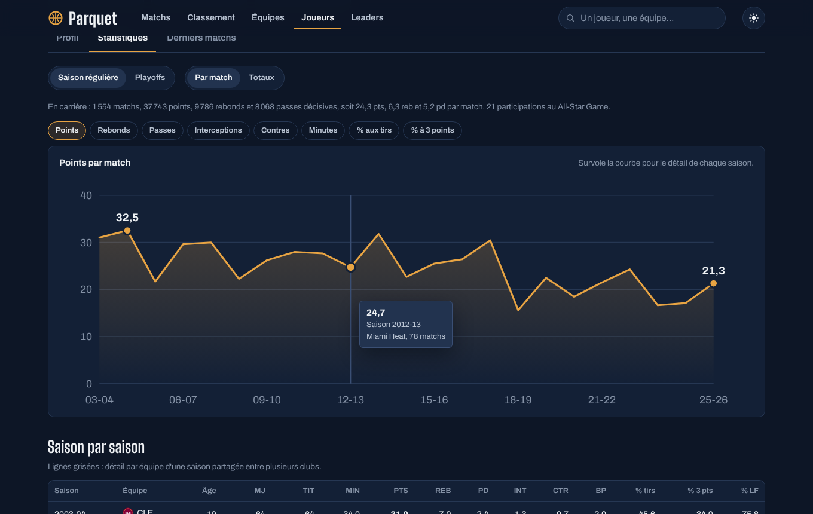
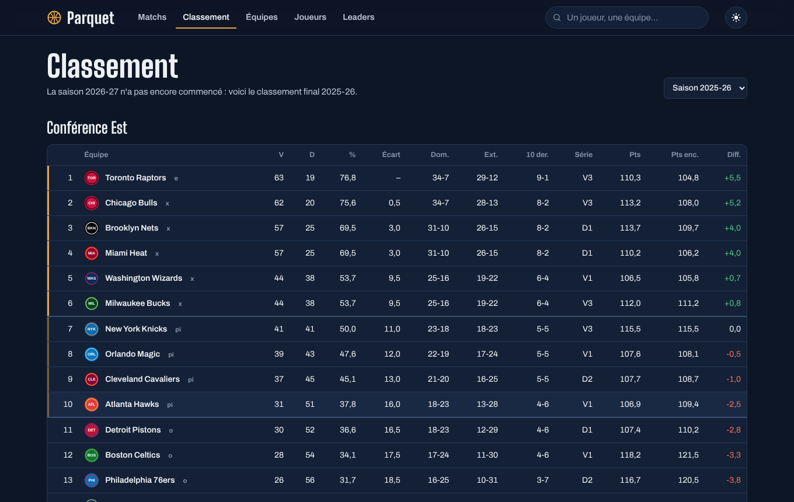
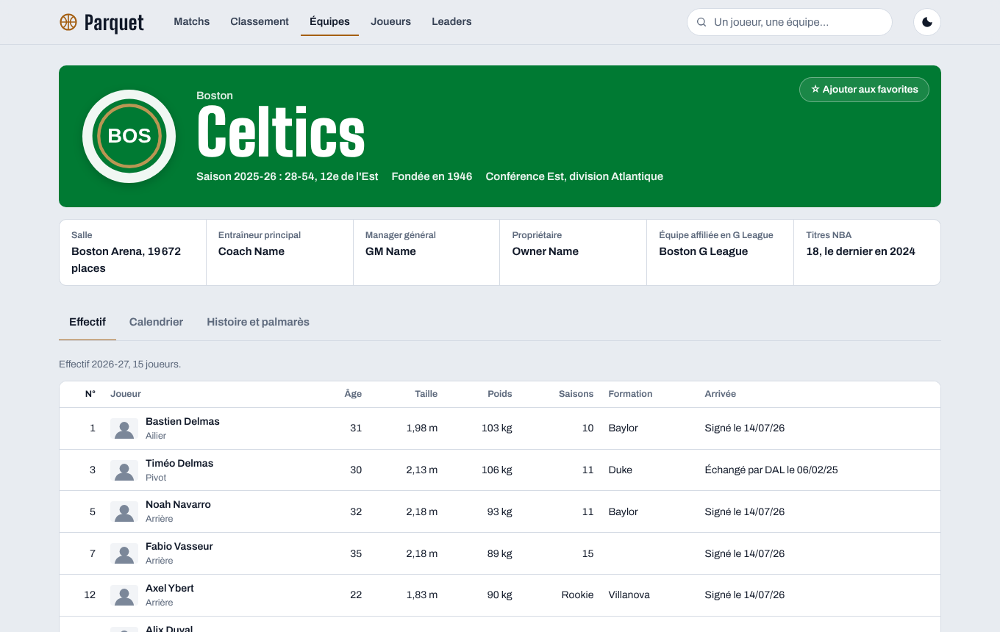
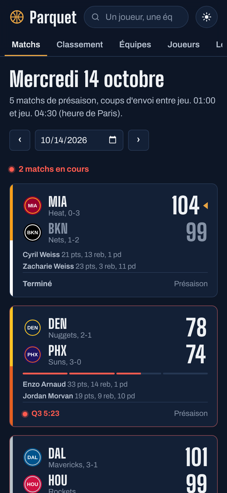
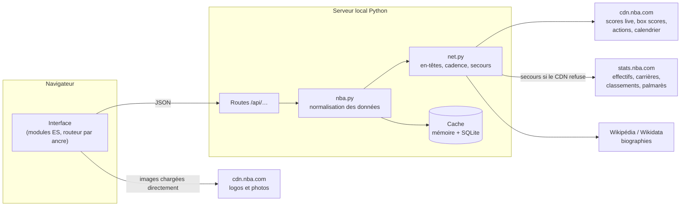

# Parquet

**Un tableau de bord NBA en direct doublé d'une encyclopédie, en français, qui tourne sur ton ordinateur.**

Parquet affiche les scores des matchs en temps réel, le détail de chaque rencontre (box score, fil des actions, carte des tirs) et une fiche complète pour les 30 franchises et les plus de 5 000 joueurs passés par la NBA depuis 1946. Toutes les données viennent des sources publiques de NBA.com et de Wikipédia, sans compte ni clé d'API.



<sub>Les captures de cette page utilisent des données de démonstration : joueurs fictifs, logos remplacés par des pastilles.</sub>

## Fonctionnalités

**Suivi des matchs**
- Scores de la journée rafraîchis automatiquement pendant les matchs, avec l'avancement de chaque quart-temps.
- Horaires convertis à l'heure de Paris, navigation de jour en jour jusque dans les saisons passées.
- Page de match : score par quart-temps, duel statistique des deux équipes, meilleurs joueurs, box score complet, fil des actions filtrable et carte des tirs.
- Avant le coup d'envoi : forme récente des deux équipes. La page bascule seule en mode direct au début du match.

**Encyclopédie**
- Équipes : effectif, staff, calendrier, résumé historique, titres, maillots retirés, membres du Hall of Fame, victoires saison par saison.
- Joueurs : recherche dans toute l'histoire de la ligue, filtres (équipe, poste, pays), biographie, palmarès, parcours, records, statistiques de carrière en graphique et en tableau, derniers matchs.
- Classement par conférence et leaders statistiques de la saison.

**Confort**
- Recherche instantanée accessible partout (touche `/`).
- Équipes favorites mises en avant, thème sombre ou clair, mise en page adaptée au téléphone.
- Page « État des sources » pour diagnostiquer un problème de connexion.

## Captures

| Match en direct | Carte des tirs |
| --- | --- |
|  |  |
| **Statistiques d'un joueur** | **Classement** |
|  |  |
| **Fiche d'équipe, thème clair** | **Sur téléphone** |
|  |  |

## Stack technique

| Couche | Choix | Pourquoi |
| --- | --- | --- |
| Serveur | Python 3.9+, bibliothèque standard (`http.server`, `sqlite3`) et `requests` | Une seule dépendance, installation en un double-clic |
| Cache | SQLite + cache mémoire LRU | Réponses instantanées, fonctionnement dégradé hors ligne |
| Interface | HTML, CSS et JavaScript (modules ES) sans framework ni étape de build | Code lisible, aucun outillage à installer |
| Graphiques | SVG écrit à la main | Contrôle total du rendu, accessibilité clavier |
| Données | CDN et API stats de NBA.com, Wikipédia, Wikidata | Sources gratuites et publiques |

## Architecture



Le navigateur ne parle qu'au serveur local, qui interroge les sources, normalise les réponses dans un format stable et les met en cache. Le détail (routes, durées de cache, modèle de données) est dans [docs/ARCHITECTURE.md](docs/ARCHITECTURE.md).

## Points techniques notables

**Travailler avec des API non documentées.** Les flux de NBA.com n'ont pas de documentation publique. Leur format a été relevé sur des réponses réelles, puis chaque champ est lu de façon défensive. Les requêtes reprennent les en-têtes du site officiel, avec un second jeu en secours, et la cadence vers `stats.nba.com` est limitée (deux requêtes simultanées, espacement minimal) pour ne pas être bridé.

**Résilience.** Chaque donnée a une durée de fraîcheur adaptée : 8 secondes pour un match en cours, 6 heures pour un match terminé, une journée pour l'histoire d'une franchise. Si une source ne répond pas, le serveur renvoie la dernière version connue et l'interface l'indique par un bandeau, plutôt qu'une page d'erreur. Si le CDN refuse l'accès, scores, box scores et actions basculent automatiquement sur les endpoints équivalents de `stats.nba.com`.

**Temps réel sans WebSocket.** L'interface interroge le serveur à un rythme qui dépend de l'état des matchs (15 secondes en direct, plus lent avant le coup d'envoi, arrêt quand rien ne bouge) et se met en pause quand l'onglet est masqué. Un panier marqué fait brièvement ressortir le score.

**Le bon article Wikipédia.** Plusieurs joueurs portent le même nom. Plutôt qu'une recherche textuelle, Parquet interroge Wikidata avec l'identifiant NBA.com du joueur (propriété P3647) pour trouver l'article exact, en français s'il existe.

**Visualisation.** Courbe de carrière avec réticule et infobulle, colonnes de victoires par saison, duel des équipes en barres opposées, carte des tirs dessinée dans le système de coordonnées de la NBA (dixièmes de pied, panier en origine). Les couleurs d'équipe sont choisies selon leur contraste avec le fond, et deux équipes aux couleurs trop proches sont différenciées (distance mesurée dans l'espace OKLab).

**Localisation.** Dates et nombres au format français, tailles en mètres, poids en kilos, postes, récompenses et indicateurs de classement traduits, horaires à l'heure locale.

**Sécurité et accessibilité.** Les textes issus des sources sont toujours insérés comme du texte (jamais via `innerHTML`). Le serveur n'écoute que sur la machine locale par défaut et refuse toute sortie du dossier `web/`. Navigation au clavier, focus visible, mouvements réduits respectés.

## Lancer le projet

```bash
git clone <adresse-du-dépôt> parquet-nba
cd parquet-nba
python -m pip install -r requirements.txt
python run.py
```

L'application s'ouvre sur `http://localhost:8765/`. Sous Windows et macOS, les lanceurs `lancer.bat` et `lancer.command` créent l'environnement Python et démarrent tout en un double-clic. Le [guide d'utilisation](docs/GUIDE-UTILISATEUR.md) détaille l'installation, l'accès depuis un téléphone et le dépannage.

Options de `run.py` : `--port`, `--lan` (accès depuis le réseau local), `--no-browser`, `--diagnostic` (teste les sources puis s'arrête), `--vider-cache`.

## Tests

```bash
python -m unittest discover -s tests -t . -v
```

Les tests couvrent la mise en forme des données (à partir d'échantillons au format réel de NBA.com), la détection des paniers dans le fil des actions et le comportement du cache, y compris le repli sur des données périmées. Ils tournent sans accès réseau et sont lancés par GitHub Actions sur Python 3.9, 3.11 et 3.13.

## Organisation du code

```
parquet-nba/
├── run.py                  point d'entrée (serveur, ouverture du navigateur, diagnostic)
├── parquet/                serveur Python
│   ├── server.py           serveur HTTP, routes /api, fichiers statiques
│   ├── nba.py              récupération et normalisation des données NBA
│   ├── net.py              accès réseau : en-têtes, cadence, gestion des erreurs
│   ├── cache.py            cache mémoire + SQLite avec repli sur données périmées
│   ├── wiki.py             biographies via Wikidata et Wikipédia
│   └── teams_meta.py       les 30 franchises (couleurs, conférences, articles)
├── web/                    interface
│   ├── index.html, css/, fonts/
│   └── js/                 routeur, composants, graphiques SVG, une vue par page
├── tests/                  tests unitaires
└── docs/                   guide d'utilisation, architecture, captures
```

## Données, droits et licence

- **Code** : licence [MIT](LICENSE).
- **Polices** : Archivo et Big Shoulders Display, incluses sous licence SIL Open Font License (fichiers dans `web/fonts/`).
- **Données, logos et photos NBA** : ils ne sont pas inclus dans ce dépôt. L'application les télécharge au moment de l'utilisation, depuis les sources publiques de NBA.com, et ils restent la propriété de la NBA et de leurs ayants droit. Les conditions d'utilisation de NBA.com réservent ces contenus à un usage personnel : Parquet est conçu pour être lancé par chacun sur son propre ordinateur, pas pour être hébergé publiquement.
- **Textes Wikipédia** : affichés avec un lien vers l'article et la mention de la licence CC BY-SA.

Parquet est un projet personnel indépendant, sans lien avec la NBA ni ses équipes.

## Pistes d'amélioration

- Notifications de début et de fin de match pour les équipes favorites.
- Comparateur de deux joueurs, saison par saison.
- Tableau des séries pendant les playoffs.
- Application installable sur téléphone (PWA) servie depuis l'ordinateur.
