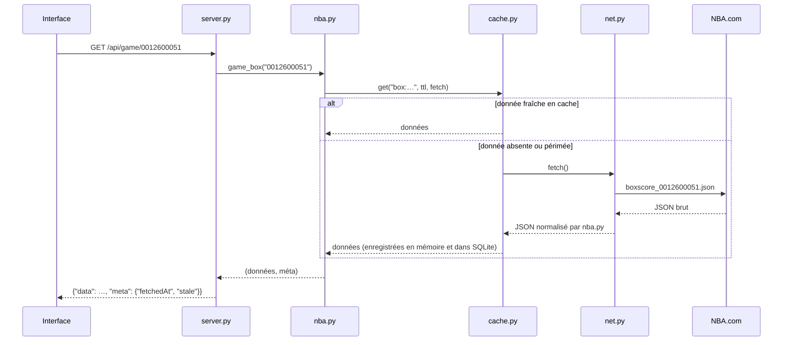

# Architecture

Parquet est composé de deux parties qui tournent sur la même machine :

1. un **serveur Python** (`parquet/`) qui interroge les sources, normalise les données et les met en cache ;
2. une **interface web** (`web/`) en JavaScript sans framework, servie par ce même serveur.

Le navigateur n'appelle jamais NBA.com directement pour les données : les sources ne l'autorisent pas depuis une autre origine (CORS) et certaines exigent des en-têtes précis. Seuls les logos et les photos sont chargés directement depuis le CDN de NBA.com, par de simples balises ``.

## Parcours d'une requête



Toutes les réponses de l'API ont la forme `{"data": …, "meta": {"fetchedAt": …, "stale": false}}`. En cas d'échec sans donnée de repli : `{"error": "message en français", "source": "stats.nba.com"}` avec un code 502 (404 pour une ressource introuvable).

## Routes de l'API

| Route | Contenu | Source principale |
| --- | --- | --- |
| `GET /api/scoreboard?date=AAAA-MM-JJ` | Matchs d'une journée NBA, journées précédente et suivante | CDN (scoreboard du jour, calendrier), sinon `scoreboardv3` |
| `GET /api/game/{id}` | En-tête du match, statistiques d'équipe, box score | CDN `boxscore`, sinon `boxscoretraditionalv3` |
| `GET /api/game/{id}/pbp` | Fil des actions, avec score courant et coordonnées des tirs | CDN `playbyplay`, sinon `playbyplayv3` |
| `GET /api/standings?season=AAAA-AA` | Classement (bascule sur la saison précédente avant le début de saison) | `leaguestandingsv3` |
| `GET /api/teams` | Les 30 équipes avec leur bilan (`?meta=1` : données fixes seulement) | `teams_meta.py` + classement |
| `GET /api/team/{id}` | Salle, staff, propriétaire, titres, maillots retirés, Hall of Fame, liens | `teamdetails` |
| `GET /api/team/{id}/roster` | Effectif et staff de la saison | `commonteamroster` |
| `GET /api/team/{id}/history` | Bilans saison par saison et totaux de la franchise | `teamyearbyyearstats`, `franchisehistory` |
| `GET /api/team/{id}/schedule` | Calendrier de la saison avec résultats | CDN calendrier |
| `GET /api/team/{id}/bio` | Introduction de l'article Wikipédia | Wikipédia |
| `GET /api/players/index` | Index compact de tous les joueurs de l'histoire | `playerindex`, sinon `commonallplayers` |
| `GET /api/player/{id}` | Identité, mensurations, draft, statistiques de la saison | `commonplayerinfo` |
| `GET /api/player/{id}/career` | Saisons, totaux de carrière, records | `playercareerstats` |
| `GET /api/player/{id}/awards` | Récompenses regroupées | `playerawards` |
| `GET /api/player/{id}/gamelog` | Derniers matchs (saison, présaison ou saison précédente) | `playergamelog` |
| `GET /api/player/{id}/bio` | Biographie Wikipédia | Wikidata (P3647) puis Wikipédia |
| `GET /api/leaders?season=AAAA-AA` | Top 10 par catégorie | `leaguedashplayerstats` |
| `GET /api/playoffs?season=AAAA-AA` | Arbre des playoffs, séries et matchs (bascule sur la saison précédente avant les playoffs) | `commonplayoffseries`, `leaguegamefinder` |
| `GET /api/recap?date=AAAA-MM-JJ` | Résumé d'une journée : joueur du match de chaque rencontre (Game Score), meilleurs de la nuit, meilleurs par catégorie, triples-doubles, match le plus serré, plus large victoire, prolongations | box scores des matchs terminés |
| `GET /api/team/{id}/calendar.ics` | Calendrier de la saison au format iCalendar (fichier à télécharger) | CDN calendrier |
| `GET /api/game/{id}/extras` | Résumé vidéo NBA.com, moments décisifs (extraits vidéo), clés du match, article, faits marquants | page du match sur www.nba.com (données `__NEXT_DATA__`) + fil des actions |
| `GET /api/game/{id}/video` | Résumé officiel du match sur YouTube (identifiant, intégrable ou non) et lien de recherche | flux de la chaîne NBA, puis API YouTube si une clé est réglée |
| `GET /api/videos/night?date=AAAA-MM-JJ` | « Nightly Recap » et « Top 10 Plays of the Night » de la journée | idem |
| `GET /api/injuries?team=&game=` | Dernier rapport officiel des blessures, lu et traduit | PDF publié par la NBA toutes les 15 minutes |
| `GET /api/transactions?team=&player=&type=&days=` | Signatures, échanges, joueurs libérés, contrats | liste officielle des mouvements (`NBA_Player_Movement.json`) |
| `GET /api/settings` · `POST /api/settings/youtube` | État de la clé YouTube (jamais la clé elle-même) ; enregistrement après vérification | `data/settings.json` |
| `GET /api/status` | Version, saison, journée NBA, mode démo | Parquet |
| `GET /api/diagnostic` | Test de chaque source | toutes |


## Durées de cache

| Donnée | Fraîcheur |
| --- | --- |
| Scores du jour | 8 s si un match est en cours, 20 s juste avant un coup d'envoi, 60 s sinon |
| Box score et actions | 8 s en direct, 6 h une fois le match terminé |
| Calendrier de la saison | 30 min |
| Scores d'une journée passée | 6 h, puis 7 jours au-delà de trois jours |
| Classement | 20 min (saison en cours), 24 h (saisons passées) |
| Effectif | 6 h |
| Fiche, carrière d'un joueur | 6 h |
| Derniers matchs d'un joueur | 20 min |
| Leaders | 1 h |
| Playoffs | 1 h (saison en cours), 24 h (saisons passées) |
| Résumé d'une journée | recalculé dès qu'un match se termine ; 6 h une fois tous les matchs terminés (mémoire seule) |
| Histoire, palmarès, index des joueurs | 24 h |
| Textes Wikipédia | 7 jours |
| Page d'un match sur NBA.com | 5 min pendant le match, 10 min ensuite, 7 jours une fois les vidéos publiées |
| Vidéo YouTube d'un match | 60 jours une fois trouvée, nouvel essai toutes les 20 min sinon |
| Flux de la chaîne YouTube de la NBA | 15 min (mémoire seule) |
| Rapport des blessures | 15 min |
| Transactions | 1 h |

Le cache (`parquet/cache.py`) garde les entrées récentes en mémoire et toutes les entrées dans `data/cache.sqlite3`. Un verrou par clé évite de lancer deux fois la même requête quand plusieurs onglets demandent la même donnée. Quand la source échoue, la dernière version connue est renvoyée avec `"stale": true`.

## Stratégie réseau

- **En-têtes** : les requêtes reproduisent celles du site www.nba.com (`Origin`, `Referer`, `Sec-Fetch-*`, agent utilisateur récent). En cas d'échec, un second jeu d'en-têtes est essayé.
- **Cadence** : au plus deux requêtes simultanées vers `stats.nba.com`, espacées d'au moins 350 ms. Les paramètres sont envoyés triés, l'API y étant sensible.
- **Bascule** : si le scoreboard du CDN est refusé, le CDN est mis de côté pendant 10 minutes et toutes les données de match passent par `stats.nba.com`.
- **Ressources pas encore publiées** : un 403 du CDN sur le box score d'un match à venir n'est pas une erreur ; la page affiche l'avant-match et se met à jour seule au coup d'envoi.

## Vidéos, blessures et transactions (`parquet/extras.py`)

- **Page d'un match sur www.nba.com.** Elle contient, dans le bloc `__NEXT_DATA__` intégré à la page, le résumé vidéo officiel (lien vers NBA.com : la vidéo elle-même demande un jeton, elle n'est pas intégrable), les « moments décisifs » avec des extraits MP4 lisibles directement depuis `videos.nba.com`, et le rapport d'analyse (meilleur défenseur, difficulté des tirs, hommes du match). Seuls les champs utiles sont extraits, et seuls les liens https vers des domaines de la NBA sont conservés.
- **Faits marquants.** Ils sont tirés du fil des actions déjà chargé : fautes techniques (sauf les trois secondes défensives), flagrantes 1 et 2, expulsions, challenges des entraîneurs.
- **YouTube.** Le flux public de la chaîne de la NBA (15 dernières vidéos) suffit pour les matchs de la nuit. Pour les autres, l'API YouTube est interrogée avec la clé de l'utilisateur (recherche limitée à la chaîne de la NBA et aux jours qui suivent le match). Un titre n'est retenu que s'il correspond exactement (« HEAT at CLIPPERS | FULL GAME HIGHLIGHTS | November 4, 2026 »). Le point oEmbed indique si la vidéo peut être intégrée. Dans la page, le lecteur ne se charge qu'au clic, depuis `youtube-nocookie.com`.
- **Rapport des blessures.** La NBA publie un PDF toutes les 15 minutes. La page officielle de la saison donne les rapports du jour ; à défaut, Parquet remonte le temps par tranches de 15 minutes. Le PDF est lu avec `pypdf` (pur Python, donc aussi sur Android) : chaque mot est récupéré avec sa position, les colonnes sont repérées grâce à l'en-tête du tableau, et les motifs écrits sur plusieurs lignes sont rattachés à la ligne de joueur la plus proche. Date, match et équipe ne sont écrits qu'une fois par bloc et valent pour les lignes suivantes, y compris d'une page à l'autre. Statuts et motifs sont traduits par dictionnaire (partie du corps, côté accordé, type de blessure) ; un motif contenant un mot inconnu reste en anglais plutôt que d'être mal traduit. Les joueurs sont reliés à leur fiche par leur nom, les matchs au calendrier.
- **Transactions.** Le fichier officiel liste tous les mouvements depuis 2015. Chaque description est réécrite en français quand sa forme est reconnue (signature et type de contrat, joueur libéré, récupéré via les waivers, contrat converti, échange avec choix de draft), sinon le texte original est affiché.
- **Clé YouTube.** Elle est stockée dans `data/settings.json` (droits limités au propriétaire), ou fournie par la variable `PARQUET_YOUTUBE_KEY`. L'API ne renvoie jamais la clé, seulement ses quatre derniers caractères. L'enregistrement (`POST`) vérifie la clé auprès de YouTube et refuse toute requête dont l'en-tête `Origin` ne correspond pas à Parquet, pour qu'aucun autre site ouvert dans le navigateur ne puisse modifier les réglages.

## Sur Android, sans ordinateur

Le serveur est en Python standard (plus `requests`) : il tourne tel quel dans Termux, l'environnement Linux pour Android. `installer-android.sh` installe Python et Git avec le gestionnaire de paquets de Termux, sans aucune question (le script est lu depuis `curl | bash`, aucune commande ne doit lire l'entrée). Il clone le dépôt, crée un environnement Python dédié et installe la commande `parquet` (`android/parquet`) ainsi que deux raccourcis pour le widget Termux:Widget.

`parquet` vérifie d'abord si une instance répond déjà sur `/api/status` ; sinon il prend un verrou de veille (`termux-wake-lock`), lance `run.py` sur un port fixe (`--port-fixe` : pas de port de secours, qui ferait ouvrir une page vide) et ouvre le navigateur avec `termux-open-url` dès que le serveur répond. `parquet stop` envoie SIGTERM, que `run.py` traite comme Ctrl+C. Le serveur réutilise son adresse après un arrêt (`SO_REUSEADDR`, hors Windows), pour qu'un redémarrage immédiat retrouve le même port, donc la même origine, les mêmes favoris et la même application installée.

Sur le téléphone, l'adresse est `http://localhost` : les navigateurs la considèrent comme sécurisée, l'application s'installe et les notifications fonctionnent sans HTTPS.

## Mode démonstration

`python run.py --demo` remplace la fonction d'accès réseau de `net.py` par `parquet/demo.py`, qui répond à la place de NBA.com et de Wikipédia avec des données fictives au même format : scores en direct, box scores, fil des actions, calendrier, carrières, palmarès, classements, leaders, playoffs, biographies, page d'un match (sans vraie vidéo), rapport des blessures, transactions. Le générateur pseudo-aléatoire a une graine fixe : les données sont identiques à chaque lancement, ce qui permet les tests d'interface et la génération des captures. Les identifiants des joueurs fictifs ne correspondent à aucun vrai joueur, pour ne jamais associer la photo d'un joueur réel à des données inventées.

## Modèle de données normalisé

Les trois formats de match de NBA.com (scoreboard live, calendrier, `scoreboardv3`) sont ramenés à une seule forme :

```json
{
  "id": "0012600051",
  "kind": "pre",
  "status": 2,
  "statusText": "Q3 5:23",
  "period": 3,
  "clock": "5:23",
  "start": "2026-10-14T23:30:00Z",
  "etDate": "2026-10-14",
  "label": "Preseason",
  "arena": "…",
  "tv": ["NBA TV"],
  "away": {"id": 1610612743, "tri": "DEN", "score": 78, "periods": [23, 29, 26], "wins": 2, "losses": 1},
  "home": {"id": 1610612756, "tri": "PHX", "score": 74, "periods": [22, 24, 28], "wins": 3, "losses": 0},
  "leaders": {"away": {"id": 0, "name": "…", "pts": 0, "reb": 0, "ast": 0}, "home": null}
}
```

`kind` vient du troisième caractère de l'identifiant du match : `1` présaison, `2` saison régulière, `4` playoffs, `5` play-in, `6` finale de la NBA Cup. `etDate` est la « journée NBA » en heure de New York, l'interface convertit ensuite les horaires dans le fuseau du navigateur.

## Interface

| Fichier | Rôle |
| --- | --- |
| `js/app.js` | Démarrage, thème, déclaration des routes |
| `js/router.js` | Routeur par ancre (`#/joueur/2544`) ; chaque page reçoit un contexte qui annule ses requêtes et ses minuteries quand on la quitte |
| `js/dom.js` | Création d'éléments sans `innerHTML` pour les données |
| `js/components.js` | Logos, photos, tuiles de match, tableaux triables, onglets, états de chargement et d'erreur |
| `js/charts.js` | Courbe, colonnes, duel d'équipes, carte des tirs (SVG) |
| `js/format.js` | Formats français : nombres, dates, tailles, postes, pays, statuts de match |
| `js/teams.js` | Données des équipes, choix de couleurs lisibles (contraste, distance OKLab) |
| `js/search.js` | Recherche globale (joueurs et équipes, sans accents) |
| `js/spoiler.js` | Mode anti-spoiler : état global et mémoire de session des scores révélés |
| `js/notifications.js` | Alertes de match (coup d'envoi, fin serrée selon la définition NBA, résultat), mémoire des alertes envoyées, détection des connexions non sécurisées |
| `js/icons.js` | Icônes SVG |
| `js/views/stage.js` | Scène d'ouverture de l'accueil : le joueur du match de chaque rencontre (portrait détouré, nom ajusté à la largeur, couleurs d'équipe, défilement automatique, onglets, glissement au doigt) |
| `js/views/recap.js` | « La nuit en chiffres » sur l'accueil, avec les vidéos de la nuit |
| `js/menu.js` | Accueil sans en-tête : logo et bouton flottants, menu plein écran qui reprend la recherche et les boutons de l'en-tête (déplacés, puis remis en place en quittant l'accueil) |
| `js/scroll.js` | Défilement doux à la molette, sommaire numéroté de la page, apparition des sections, boucle d'animation (position et vitesse de défilement) pour les effets de profondeur et le bandeau des scores, compteurs ; tout est coupé si le système demande moins d'animations |
| `js/views/infos.js` | Page « Infos » : rapport des blessures et transactions |
| `js/media.js` | Lecteur YouTube léger (chargé au clic), extraits des moments décisifs, carte du résumé NBA.com |
| `js/news.js` | Affichage partagé des blessures (statuts colorés) et des transactions |
| `js/views/multi.js` | Mode multi-matchs |
| `js/views/*.js` | Une vue par page |
| `sw.js` | Service worker : réseau d'abord, cache en secours hors ligne, cache d'API limité à 150 réponses, version par numéro de version |

Les logos existent en deux versions sur le CDN de NBA.com, pour fond clair (`L`) et pour fond sombre (`D`) : l'interface choisit selon le thème et revient à la version claire si l'autre manque. Sur les bandeaux aux couleurs d'une équipe, le logo est posé sur une pastille claire pour rester lisible.
