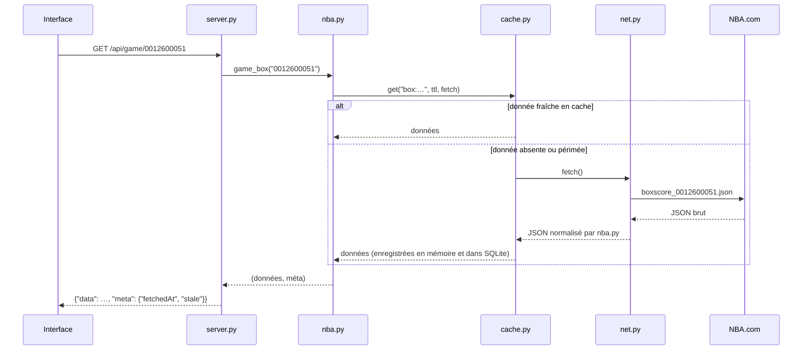

# Architecture

Parquet est composé de deux parties qui tournent sur la même machine :

1. un **serveur Python** (`parquet/`) qui interroge les sources, normalise les données et les met en cache ;
2. une **interface web** (`web/`) en JavaScript sans framework, servie par ce même serveur.

Le navigateur n'appelle jamais NBA.com directement pour les données : les sources ne l'autorisent pas depuis une autre origine (CORS) et certaines exigent des en-têtes précis. Seuls les logos et les photos sont chargés directement depuis le CDN de NBA.com, par de simples balises ``.

## Parcours d'une requête



Toutes les réponses de l'API ont la forme `{"data": …, "meta": {"fetchedAt": …, "stale": false}}`. En cas d'échec sans donnée de repli : `{"error": "message en français", "source": "stats.nba.com"}` avec un code 502 (404 pour une ressource introuvable).

## Routes de l'API

| Route | Contenu | Source principale |
| --- | --- | --- |
| `GET /api/scoreboard?date=AAAA-MM-JJ` | Matchs d'une journée NBA, journées précédente et suivante | CDN (scoreboard du jour, calendrier), sinon `scoreboardv3` |
| `GET /api/game/{id}` | En-tête du match, statistiques d'équipe, box score | CDN `boxscore`, sinon `boxscoretraditionalv3` |
| `GET /api/game/{id}/pbp` | Fil des actions, avec score courant et coordonnées des tirs | CDN `playbyplay`, sinon `playbyplayv3` |
| `GET /api/standings?season=AAAA-AA` | Classement (bascule sur la saison précédente avant le début de saison) | `leaguestandingsv3` |
| `GET /api/teams` | Les 30 équipes avec leur bilan (`?meta=1` : données fixes seulement) | `teams_meta.py` + classement |
| `GET /api/team/{id}` | Salle, staff, propriétaire, titres, maillots retirés, Hall of Fame, liens | `teamdetails` |
| `GET /api/team/{id}/roster` | Effectif et staff de la saison | `commonteamroster` |
| `GET /api/team/{id}/history` | Bilans saison par saison et totaux de la franchise | `teamyearbyyearstats`, `franchisehistory` |
| `GET /api/team/{id}/schedule` | Calendrier de la saison avec résultats | CDN calendrier |
| `GET /api/team/{id}/bio` | Introduction de l'article Wikipédia | Wikipédia |
| `GET /api/players/index` | Index compact de tous les joueurs de l'histoire | `playerindex`, sinon `commonallplayers` |
| `GET /api/player/{id}` | Identité, mensurations, draft, statistiques de la saison | `commonplayerinfo` |
| `GET /api/player/{id}/career` | Saisons, totaux de carrière, records | `playercareerstats` |
| `GET /api/player/{id}/awards` | Récompenses regroupées | `playerawards` |
| `GET /api/player/{id}/gamelog` | Derniers matchs (saison, présaison ou saison précédente) | `playergamelog` |
| `GET /api/player/{id}/bio` | Biographie Wikipédia | Wikidata (P3647) puis Wikipédia |
| `GET /api/leaders?season=AAAA-AA` | Top 10 par catégorie | `leaguedashplayerstats` |
| `GET /api/diagnostic` | Test de chaque source | toutes |


## Durées de cache

| Donnée | Fraîcheur |
| --- | --- |
| Scores du jour | 8 s si un match est en cours, 20 s juste avant un coup d'envoi, 60 s sinon |
| Box score et actions | 8 s en direct, 6 h une fois le match terminé |
| Calendrier de la saison | 30 min |
| Scores d'une journée passée | 6 h, puis 7 jours au-delà de trois jours |
| Classement | 20 min (saison en cours), 24 h (saisons passées) |
| Effectif | 6 h |
| Fiche, carrière d'un joueur | 6 h |
| Derniers matchs d'un joueur | 20 min |
| Leaders | 1 h |
| Histoire, palmarès, index des joueurs | 24 h |
| Textes Wikipédia | 7 jours |

Le cache (`parquet/cache.py`) garde les entrées récentes en mémoire et toutes les entrées dans `data/cache.sqlite3`. Un verrou par clé évite de lancer deux fois la même requête quand plusieurs onglets demandent la même donnée. Quand la source échoue, la dernière version connue est renvoyée avec `"stale": true`.

## Stratégie réseau

- **En-têtes** : les requêtes reproduisent celles du site www.nba.com (`Origin`, `Referer`, `Sec-Fetch-*`, agent utilisateur récent). En cas d'échec, un second jeu d'en-têtes est essayé.
- **Cadence** : au plus deux requêtes simultanées vers `stats.nba.com`, espacées d'au moins 350 ms. Les paramètres sont envoyés triés, l'API y étant sensible.
- **Bascule** : si le scoreboard du CDN est refusé, le CDN est mis de côté pendant 10 minutes et toutes les données de match passent par `stats.nba.com`.
- **Ressources pas encore publiées** : un 403 du CDN sur le box score d'un match à venir n'est pas une erreur ; la page affiche l'avant-match et se met à jour seule au coup d'envoi.

## Modèle de données normalisé

Les trois formats de match de NBA.com (scoreboard live, calendrier, `scoreboardv3`) sont ramenés à une seule forme :

```json
{
  "id": "0012600051",
  "kind": "pre",
  "status": 2,
  "statusText": "Q3 5:23",
  "period": 3,
  "clock": "5:23",
  "start": "2026-10-14T23:30:00Z",
  "etDate": "2026-10-14",
  "label": "Preseason",
  "arena": "…",
  "tv": ["NBA TV"],
  "away": {"id": 1610612743, "tri": "DEN", "score": 78, "periods": [23, 29, 26], "wins": 2, "losses": 1},
  "home": {"id": 1610612756, "tri": "PHX", "score": 74, "periods": [22, 24, 28], "wins": 3, "losses": 0},
  "leaders": {"away": {"id": 0, "name": "…", "pts": 0, "reb": 0, "ast": 0}, "home": null}
}
```

`kind` vient du troisième caractère de l'identifiant du match : `1` présaison, `2` saison régulière, `4` playoffs, `5` play-in, `6` finale de la NBA Cup. `etDate` est la « journée NBA » en heure de New York, l'interface convertit ensuite les horaires dans le fuseau du navigateur.

## Interface

| Fichier | Rôle |
| --- | --- |
| `js/app.js` | Démarrage, thème, déclaration des routes |
| `js/router.js` | Routeur par ancre (`#/joueur/2544`) ; chaque page reçoit un contexte qui annule ses requêtes et ses minuteries quand on la quitte |
| `js/dom.js` | Création d'éléments sans `innerHTML` pour les données |
| `js/components.js` | Logos, photos, tuiles de match, tableaux triables, onglets, états de chargement et d'erreur |
| `js/charts.js` | Courbe, colonnes, duel d'équipes, carte des tirs (SVG) |
| `js/format.js` | Formats français : nombres, dates, tailles, postes, pays, statuts de match |
| `js/teams.js` | Données des équipes, choix de couleurs lisibles (contraste, distance OKLab) |
| `js/search.js` | Recherche globale (joueurs et équipes, sans accents) |
| `js/views/*.js` | Une vue par page |

Les logos existent en deux versions sur le CDN de NBA.com, pour fond clair (`L`) et pour fond sombre (`D`) : l'interface choisit selon le thème et revient à la version claire si l'autre manque. Sur les bandeaux aux couleurs d'une équipe, le logo est posé sur une pastille claire pour rester lisible.
